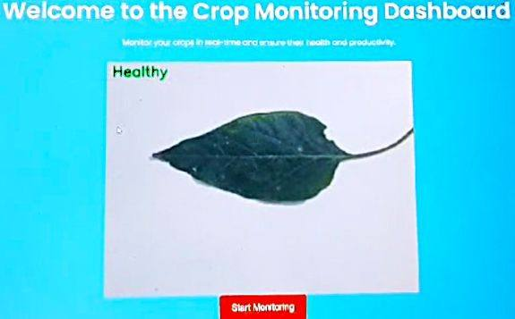
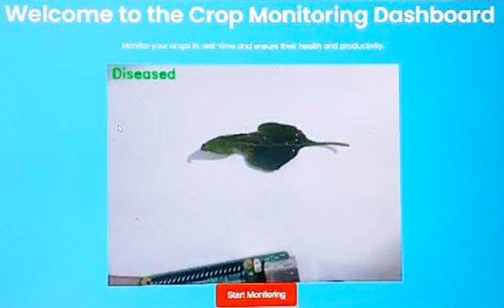
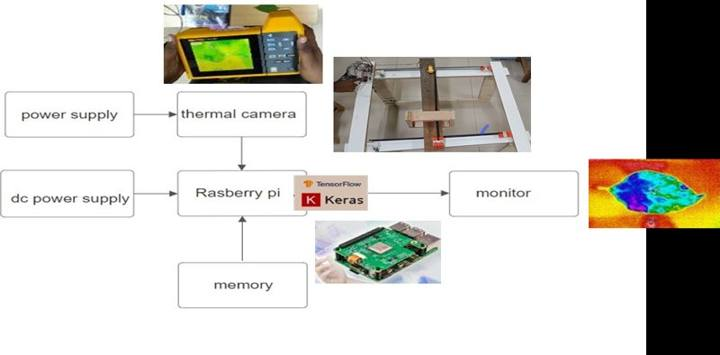
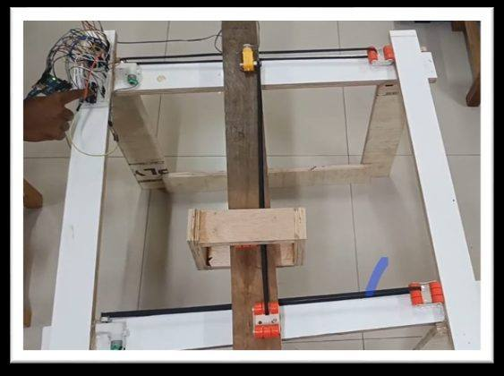
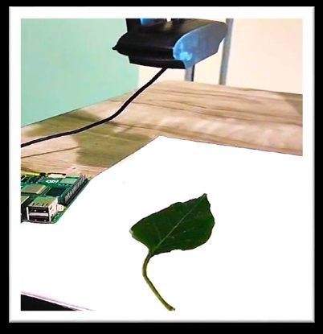
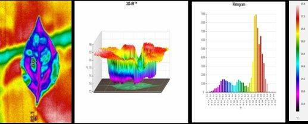
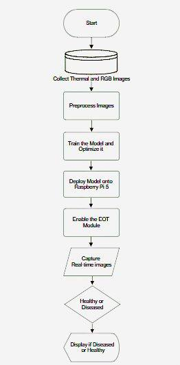
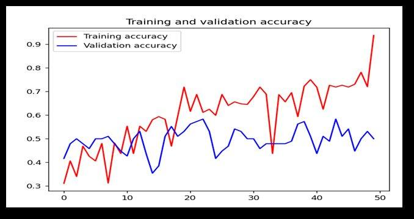
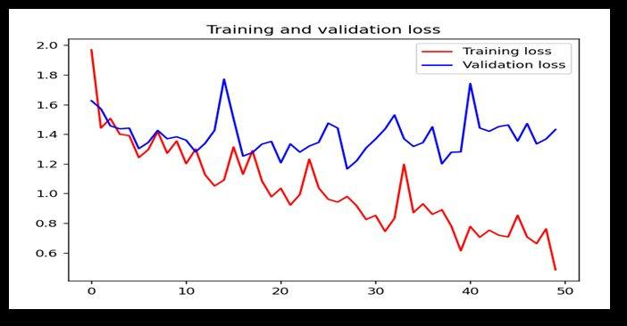

# 🌱 Disease Detection in Plants using AI and Thermal Imaging

> A real-time crop monitoring system that uses a **CNN**, **thermal + RGB imaging**, a **Raspberry Pi 5** and an **Electronic Overhead Travel (EOT)** gantry to detect plant diseases in a greenhouse — before visible symptoms spread.


<p align="center">
  
  &nbsp;
  
</p>

---

## 📖 Overview

Plant diseases threaten global food security and cause significant crop losses. Early detection is crucial for effective management, but manual inspection is slow and symptoms are often visible only after the damage is done.

This project automates disease detection using AI and thermal imaging. A **Convolutional Neural Network (CNN)** built with TensorFlow/Keras classifies leaves as **healthy** or **diseased** from thermal and visual images. The model runs on a **Raspberry Pi 5** and is combined with an **Arduino-driven EOT system** that moves the camera over the plants, so a greenhouse can be scanned automatically. Results are streamed to a **Flask web dashboard** for the farmer.

The model was trained to detect **whitefly** infestation, showing how well it can distinguish diseased from healthy plants before being extended to more diseases.

## ✨ Key Features

- 🔥 **Thermal + visual imaging** — temperature variations on the leaf reveal stress early
- 🧠 **Lightweight CNN** — optimised for edge devices, with pruning and quantisation for low compute
- 🍓 **Runs on Raspberry Pi 5** — real-time, on-device inference with no cloud needed
- 🏗️ **EOT gantry (Arduino)** — automated scanning of plants without human intervention
- 🌐 **Web dashboard** — Flask app that shows *Healthy* / *Diseased* results in real time
- 💰 **Low cost** — whole prototype built for about ₹30,500

## 🏗️ System Design

<p align="center">
  
</p>

Power supply → thermal/RGB camera → **Raspberry Pi 5 running the TensorFlow/Keras model** → monitor and web dashboard.

| EOT Module | Camera Module |
|:---:|:---:|
|  |  |

### Thermal image analysis

<p align="center">
  
</p>

## ⚙️ How It Works



1. **Collect data** — thermal and RGB images of healthy and diseased plants from nearby farms
2. **Pre-process** — segment, denoise, resize to 128×128, convert to grayscale and normalise
3. **Train** the CNN disease-detection model
4. **Optimise** the model with more data, plus pruning and quantisation
5. **Deploy** the model on the Raspberry Pi 5 and check power and compatibility
6. **Enable the EOT module** to scan plants automatically
7. **Capture** real-time images and pre-process them
8. **Classify** each image as healthy or diseased
9. **Display** the result on the crop monitoring dashboard
10. **Store** the results for further analysis and improvement

<br clear="right"/>

## 🧠 Model Architecture

```text
Input (128 × 128 × 1, grayscale)
 → Conv2D(32, 3×3, ReLU) → MaxPooling(2×2)
 → Conv2D(64, 3×3, ReLU) → MaxPooling(2×2)
 → Flatten → Dense(64, ReLU) → Dense(1, Sigmoid)

Optimizer: Adam   Loss: Binary Cross-Entropy   Metric: Accuracy
```

## 📊 Results

| Metric | Value |
|---|---|
| Training accuracy | **~90%** |
| Validation accuracy | **~80%** |
| Epochs | 50 |

| Accuracy | Loss |
|:---:|:---:|
|  |  |

The model gives a correct result about **8 out of 10 times**. The gap between training and validation curves shows some overfitting, which is addressed in the future work below.

## 📂 Project Structure

```text
precision-agriculture-ai/
├── src/
│   ├── preprocess.py        # resize, grayscale, normalise, reshape
│   ├── model.py             # CNN architecture
│   ├── main.py              # training script
│   ├── inference.py         # predict on a single image
│   ├── evaluate_model.py    # evaluate on a test set
│   ├── ensemble_model.py    # average predictions from several models
│   ├── capture_monitor.py   # live camera feed
│   ├── testing.py           # camera / image sanity check
│   ├── server.py            # Flask web dashboard
│   └── templates/index.html # dashboard UI
├── images/                  # figures and prototype photos
├── requirements.txt
└── README.md
```

## 🚀 Getting Started

```bash
git clone https://github.com/MelbinManoj/precision-agriculture-ai.git
cd precision-agriculture-ai
pip install -r requirements.txt
cd src
```

**1. Prepare the dataset**

```text
data/train/healthy/   data/train/diseased/
data/val/healthy/     data/val/diseased/
data/test/healthy/    data/test/diseased/
```

**2. Train the model.** Set the paths in `main.py`, then run:

```bash
python main.py            # saves plant_disease_model.h5
```

**3. Evaluate it, or predict on one image**

```bash
python evaluate_model.py
python inference.py
```

**4. Launch the dashboard**

```bash
python server.py          # open http://<raspberry-pi-ip>:5000
```

## 🔩 Hardware

| Component | Purpose |
|---|---|
| Raspberry Pi 5 (8 GB) | Runs the AI model and real-time detection |
| Thermal camera | Captures temperature variations on leaves |
| RGB camera / webcam | Adds visual data for classification |
| EOT system (Arduino + motors + wooden frame) | Moves the camera to scan the plants |
| Power supply and cooling | Keeps the Raspberry Pi and other components running reliably |

### 💰 Cost Estimate

| Category | Description | Cost (₹) |
|---|---|---:|
| Materials | Raspberry Pi 5, camera module, wood, Arduino, motors | 25,000 |
| Equipment | Silicon glue and gun, power cable | 4,000 |
| Labour | Wood cutting | 500 |
| Transport | Shipping and delivery | 1,000 |
| **Total** | | **30,500** |

## ⚠️ Limitations

- No public thermal plant-disease dataset existed, so a **custom dataset** was built and it is still small
- Currently detects **one disease** (whitefly)
- The Raspberry Pi 5 shows some **processing delay** with heavier models
- Thermal cameras are costly, so live inference also uses an RGB camera (~75% accuracy)
- Works best in a **controlled greenhouse** environment

## 🔭 Future Work

- Expand the dataset to cover more diseases, crops and conditions, and use **transfer learning**
- Reduce overfitting with **data augmentation, dropout and early stopping**
- Add **IoT** remote monitoring and a **mobile app** for alerts and recommendations
- Scale to open fields and support **eco-friendly**, low-pesticide farming

## 🌍 Impact and SDGs

- **SDG 2: Zero Hunger.** Early detection prevents crop loss and improves food security.
- **SDG 12: Responsible Consumption and Production.** Targeted treatment means fewer pesticides.
- Low-power, on-device AI uses far less energy than cloud-based systems.

## 👤 Author

**Melbin Manoj** - B.Tech, Electronics and Communication Engineering, CHRIST (Deemed to be University), Bangalore

[GitHub](https://github.com/MelbinManoj) · [LinkedIn](https://www.linkedin.com/in/melbin-manoj-8ba512269/)
